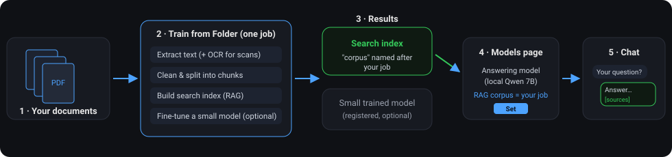
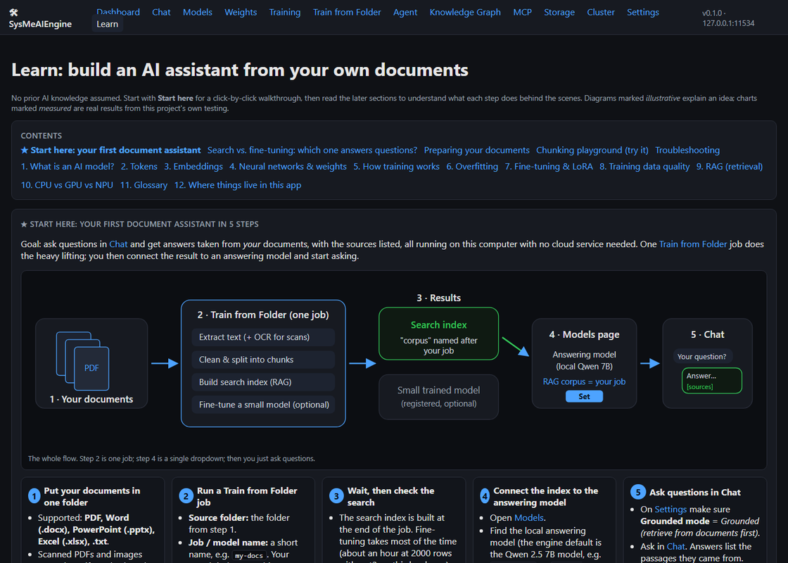
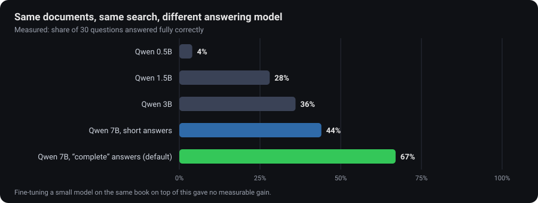
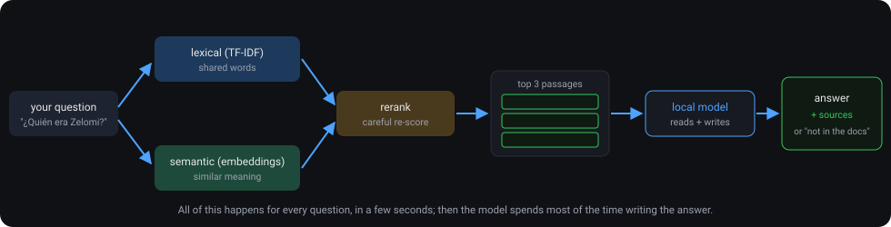
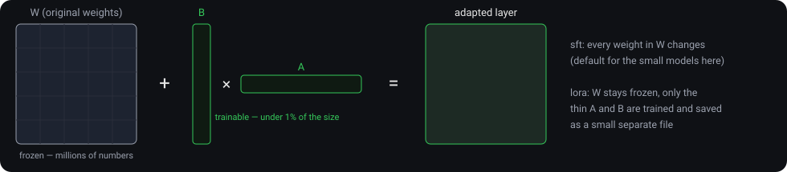

# SysMeAIEngine

[](LICENSE)


A private AI engine for Windows. You point it at your own documents, it builds a
search index over them, and a local model answers questions from those documents
with the sources listed. Nothing leaves your PC.

I built it because I wanted something like Ollama or LM Studio, but aimed at one
job: answering correctly from *my* files, on ordinary hardware, without a cloud
account. Along the way it grew a training pipeline, a weight explorer, an
OpenAI-compatible API, an MCP server and multi-PC training, and those are
all here too.

It's developed and tested on an AMD Ryzen AI laptop (CPU, with optional NPU), and it
also runs on NVIDIA CUDA GPUs when one is present.



---

##  Install

If you just want it running:

1. Install **Python 3.12** from [python.org](https://www.python.org/downloads/windows/). On the
   first screen, tick **"Add python.exe to PATH"**.
2. Download this repo (**Code → Download ZIP**, then extract it) and double-click **`install.bat`**.
   It builds the Python environment and asks whether to set up the local answering model
   (Ollama + Qwen 2.5). Say yes. It also switches Chat to answer from your documents.
3. Double-click **`start.bat`**. Your browser opens the web UI.

The first install takes a while (10 to 20 minutes, mostly Windows Defender scanning
the PyTorch download). After that it starts in seconds.

[INSTALL.md](INSTALL.md) has the full walkthrough: requirements, settings, updating,
uninstalling and a troubleshooting table. Everything below is for people who want to
know how it works or drive it from the command line.

##  Start with the Learn tab

The web UI has a **Learn** tab written for people who have never trained a model. It
walks you through your first document assistant in five steps, explains tokens,
embeddings, training, LoRA and retrieval with diagrams, and includes a chunking
playground where you can paste text and watch how it gets split. Try it with the two
short documents in [`examples/sample-docs`](examples/sample-docs). That folder also
lists test questions with their answers.



##  What actually works (measured)

The obvious idea is to fine-tune a model on your documents until it "knows" them. I
tried that for weeks, with more epochs, more data, better sampling and cleaner training
pairs. A small fine-tuned model still misspelled names and mixed up facts.

What works is retrieval (RAG). For every question, the engine searches your documents,
picks the best passages and hands them to a local model to read before it answers.
How good the answers are then depends mostly on the size of the answering model:



That's why the installer sets up Qwen 2.5 7B through Ollama and turns on grounded chat
(top 3 passages, "complete" answer style). Those are the best settings from the
measurements above. In the same tests the engine refused 100% of questions the
documents don't cover, instead of guessing.

The search side combines three methods, then reranks:



Fine-tuning still has a place: changing a model's style or vocabulary, and learning
how training works. The Weights page shows you exactly which numbers moved.

##  What's in it

- **Model backends.** Hugging Face Transformers, `llama.cpp` (GGUF), Ollama, and ONNX
  Runtime (DirectML GPU / Ryzen AI NPU). There's also a tiny built-in `minilm` model for
  smoke tests on any CPU.
- **Document pipeline.** PDF, Word, PowerPoint, Excel and text, with optional OCR for
  scans. It extracts, chunks (fixed window, sentence or paragraph), dedupes, and writes
  JSONL for SFT, LoRA or QLoRA. There's also a distillation mode that has a stronger
  model write clean question/answer pairs for a smaller one.
- **Retrieval.** A hybrid index (TF-IDF plus multilingual embeddings) with a
  cross-encoder reranker, an optional knowledge graph, and an evaluation loop
  (recall@k, hit@1, MRR).
- **Weight tools.** Tensor statistics, clip, scale, sparsify, head pruning, and
  knowledge injection, from the dashboard or the API.
- **Self-learning agent.** `agent run` searches the web (DuckDuckGo), scrapes allowed
  pages, dedupes by URL and queues the text for ingest.
- **Dashboard.** Server-rendered pages with live metrics (CPU, GPU, NPU, tokens/s,
  requests, memory). No build step.
- **APIs.** OpenAI-compatible `/v1/*`, Anthropic Messages API compatible `/anthropic/v1/messages`, and an MCP
  server over JSON-RPC.
- **Multi-PC training.** PyTorch DDP across several machines on your network.
- **Runs all day.** One command, no Docker.

A note on "self-learning", because the term gets oversold: here it means scheduled
web scraping plus ingest and fine-tune jobs that *you* approve. The live model's
weights never change on their own. That would wreck it. The agent writes to a staging
area and you trigger training from the dashboard.

---

##  Developer quick start

The manual route, if you'd rather not use `install.bat`:

```bat
:: from the folder you cloned or unzipped the project into
cd path\to\SysMeAIEngine
python -m venv .venv
.venv\Scripts\activate
pip install -r requirements.txt

:: optional: Ryzen AI / DirectML extras for NPU + GPU
pip install -r requirements-amd.txt

:: optional: OCR for scanned PDFs and image files in Train from Folder
pip install -r requirements-ocr.txt

:: start the engine (API + dashboard)
python -m src.cli engine serve
```

The repo ships a working `.env` with safe defaults (no keys in it). `.env.example` is
the same file with every setting documented. Edit `.env`, then restart.

Instead of the last line you can double-click **`start_server.bat`**. It calls
`.venv\Scripts\python.exe` directly, so it works from a fresh terminal where you never
ran `activate`. A bare `python` would pick up your system install, which doesn't have
`psutil` and friends. **`start.bat`** does the same and also opens the browser.

Then open **http://localhost:11534/ui**. The engine uses port 11534 rather than the usual
11434, so it can run next to Ollama, which takes 11434.

### First model

`install.bat` registers the built-in `minilm` for you. By hand:

```bat
:: tiny reference model (CPU, works everywhere)
python -m src.cli model register --name minilm --provider minilm --path ""

:: or download and register any Hugging Face causal LM (needs disk + RAM)
python -m src.cli model register --name qwen3-0.6b --provider hf --path Qwen/Qwen3-0.6B

:: or the local answering model through Ollama (what install.bat sets up)
python -m src.cli model register --name qwen7b-local --provider ollama --path qwen2.5:7b-instruct
```

### Chat (OpenAI-compatible)

```bat
curl http://localhost:11534/v1/chat/completions ^
  -H "Content-Type: application/json" ^
  -d "{\"model\":\"minilm\",\"messages\":[{\"role\":\"user\",\"content\":\"Hello\"}]}"
```

### Ingest an ebook

```bat
python -m src.cli ingest pdf --file C:\books\TheLinuxBook.pdf --out data\raw
python -m src.cli ingest chunk --in  data\raw --out data\chunks
python -m src.cli ingest build-dataset --chunks data\chunks --out data\datasets\ebooks.jsonl --instruction "Using the passage, answer:"
```

### Fine-tune (LoRA, fine on 8 to 16 GB of RAM)

```bat
python -m src.cli train finetune ^
  --model Qwen/Qwen3-0.6B ^
  --dataset data\datasets\ebooks.jsonl ^
  --output models/checkpoints\qwen3-ebooks-lora ^
  --method lora --epochs 1 --lr 2e-4 --batch-size 1
```



### Self-learn a topic

```bat
python -m src.cli agent run --topic "Ryzen AI NPU quantization" --results 6 --out data\raw
python -m src.cli ingest chunk --in data\raw --out data\chunks
```

---

##  CLI cheat sheet

| Area | Command |
|---|---|
| serve | `python -m src.cli engine serve` |
| register model | `python -m src.cli model register --name X --provider hf --path <hf_id>` |
| list models | `python -m src.cli model list` |
| load | `python -m src.cli model load --name X` |
| unload | `python -m src.cli model unload` |
| chat | `python -m src.cli chat --model minilm --prompt "hi"` |
| ingest | `ingest pdf / html / chunk / build-dataset` |
| train | `train finetune / distill` |
| weights | `weights inspect / edit / prune` |
| metrics | `python -m src.cli metrics` |
| agent | `agent run --topic "..." / agent status` |
| kgraph | `kgraph build / stats / query / list / delete` (knowledge-graph add-on, see docs/GROUNDING.md) |

---

##  API

### OpenAI-compatible

| Endpoint | Method | Body |
|---|---|---|
| `/v1/chat/completions` | POST | `{model, messages[], stream?, tools?, tool_choice?}` |
| `/v1/completions` | POST | `{model, prompt, max_tokens?}` |
| `/v1/embeddings` | POST | `{model, input: str \| str[]}` |
| `/v1/models` | GET | |

Anthropic Messages API aliases live under `/anthropic/v1/messages` and friends, with the same
bodies in the `anthropic.version` shape.

**Tool calling.** Both endpoints accept a standard `tools` array (OpenAI function shape
or Anthropic `input_schema` shape) for models whose chat template supports it. I've
verified it with qwen2.5-instruct's Hermes-style `<tool_call>` format. Models with no
chat template, like the gpt2-based ones, quietly ignore `tools`.

One tool is always available: `search_local_knowledge`, a local RAG search the server
runs itself. If the model calls it, the engine runs the search and loops back for a
grounded final answer, so the caller just sees a normal completion. Any other tool the
model calls (one you declared) comes back unexecuted in the usual `tool_calls` /
`tool_use` shape, for you to run and send back.

### MCP (JSON-RPC over HTTP)

`POST /mcp` with `{jsonrpc:"2.0", id, method, params}`

| Method | Result shape |
|---|---|
| `initialize` | `{protocolVersion:"2025-06-18", capabilities:{…}, serverInfo:{…}}` |
| `notifications/initialized` | `{}` |
| `ping` | `{}` |
| `tools/list` | `{tools:[…]}`: `engine.chat`, `engine.embeddings`, `engine.models`, `engine.metrics`, `engine.load`, `rag.search`, `rag.list_corpora` |
| `tools/call` | invoke a tool by `{name, arguments}` |
| `resources/list` · `resources/read` | `engine://models`, `engine://loaded`, `engine://metrics`, `engine://config`, `engine://agent/state`, `engine://datasets` |
| `prompts/list` · `prompts/get` | `engine.chat`, `engine.summarize`, `engine.embed` prompt templates |

### Legacy / direct

| Endpoint | Method | Purpose |
|---|---|---|
| `/api/chat` | POST | simple `{model, prompt}` chat |
| `/api/generate` | POST | raw generation |
| `/api/embeddings` | POST | embeddings |
| `/api/models` | GET | registry |
| `/api/metrics` | GET | dashboard metrics |
| `/health` | GET | liveness |

### Web UI

| Route | What's there |
|---|---|
| `/ui` | Dashboard: stats and charts |
| `/ui/chat` | Chat, grounded in your documents |
| `/ui/models` | Model registry, load/unload, which corpus each model searches |
| `/ui/weights` | Tensor explorer and editor |
| `/ui/training` | Build a dataset, launch fine-tuning, watch jobs |
| `/ui/train-folder` | One job: documents → chunks → index → fine-tune, plus retrieval evaluation |
| `/ui/agent` | Self-learning runs and the approval queue |
| `/ui/kgraph` | Knowledge graph built from your documents |
| `/ui/mcp` | MCP endpoint and tool explorer |
| `/ui/storage` | Files, datasets and checkpoints |
| `/ui/cluster` | Multi-PC training |
| `/ui/settings` | Grounded mode, retrieval depth, optional cloud provider |
| `/ui/help` | The Learn tab |

---

##  Layout

```
SysMeAIEngine/
├── install.bat / start.bat  # new-user installer and launcher (see INSTALL.md)
├── start_server.bat         # starts the engine without opening a browser (services, cluster nodes)
├── .env / .env.example      # working defaults / every setting documented
├── README.md  INSTALL.md  LICENSE  NOTICE
├── requirements.txt
├── requirements-amd.txt     # optional: DirectML GPU / Ryzen AI NPU / PEFT
├── requirements-ocr.txt     # optional: OCR for scanned PDFs and images
├── requirements-local-llm.txt # optional: llama.cpp in-process route (GGUF)
├── pyproject.toml
├── src/
│   ├── app.py               # process entry point (used by uvicorn)
│   ├── cli.py               # every operator command
│   ├── server.py            # build_app(): wires all routers
│   ├── core/
│   │   ├── config.py        # dataclass + from_env()
│   │   ├── state.py         # runtime state (models, loaded, agent, jobs)
│   │   ├── device_select.py # CPU / DirectML / CUDA selection + an honest capability report
│   │   ├── finetune_plan.py # shared HF fine-tune dtype/method resolution
│   │   ├── providers/       # base, registry, minilm, hf, llama_cpp, ollama, onnx_* adapters
│   │   ├── model_loader.py  # load/unload/get, tokenizer encode/decode, embeddings
│   │   ├── rag.py           # hybrid retrieval, reranking, grounded prompts
│   │   ├── metrics.py       # rolling stats, psutil + GPU/NPU probes
│   │   └── utils/           # device_probe.py (AMD CPU/NPU), logging_utils.py
│   ├── api/                 # chat, openai (compatible), models, metrics, mcp routes
│   ├── admin/               # dashboard, models, weights, training, agent, mcp, cluster UI routers
│   ├── cluster/             # multi-node: node registry, agent API, orchestrator (docs/CLUSTER.md)
│   ├── ingestion/
│   │   └── pipeline.py      # extract → chunk → dataset builders
│   └── web/templates/       # server-rendered HTML (no build step)
├── scripts/
│   ├── setup_node.ps1       # install/verify any machine (standalone, master or cluster node)
│   ├── setup_answer_model.ps1 # Ollama + Qwen 2.5 answering model, grounded chat on
│   ├── ingest_pdf.py  ingest_html.py  build_dataset.py
│   ├── finetune_model.py         # SFT + LoRA/QLoRA (single node)
│   ├── distributed_finetune.py   # same, launched per rank across a cluster
│   ├── verify_cluster_loopback.py # same-machine sanity check before a real cluster run
│   ├── distill_knowledge.py  # "knowledge grounding" QA → weight edit
│   ├── prune_model.py        # magnitude prune + tensor ops
│   ├── evaluate_model.py
│   └── agent_self_evolve.py  # web search + scrape → ingest queue
├── examples/sample-docs/    # two short documents + test questions for a first run
├── cluster-client/          # files for extra cluster PCs (see cluster-client/INSTALL.md)
├── data/                    # created on first run: raw/ chunks/ datasets/ rag_index/ kgraph/ ...
├── models/                  # created on first run: registry, checkpoints/, weights/, settings
├── docs/                    # ARCHITECTURE  TRAINING  MCP  CLUSTER  GROUNDING, images/
└── tests/                   # 339 tests, run with: python -m pytest
```

---

##  AMD NPU (Ryzen AI) setup

Read this before you try the NPU. The NPU runtime is **not on public PyPI**. That's
where the `onnxruntime-vitisai>=1.20 : No matching distribution found` error comes
from. Here's what works:

### 1. Install the NPU driver (one time)

Download and install the Ryzen AI NPU driver:
https://download.amd.com/opendownload/RyzenAI/Driver/NPU%5FRAI%5F280%5FWHQL.zip

Extract it, run `.\npu_sw_installer.exe` as Administrator, and check that **Task
Manager → Performance** shows **NPU0**.

### 2. Install the Ryzen AI Software (it creates its own conda env)

Download: https://account.amd.com/en/forms/downloads/ryzenai-eula-public-xef.html?filename=ryzen-ai-1.8.0.exe

This creates a conda env (default name `ryzen-ai-1.8.0`) with the right `onnxruntime`
build, including the **Vitis AI Execution Provider** and the support DLLs the NPU needs.

### 3. Connect it to SysMeAIEngine

Pick one of two ways.

**a. Run the engine inside the Ryzen AI conda env.** Simplest for now.

```bat
:: in Miniforge Prompt
conda activate ryzen-ai-1.8.0
cd path\to\SysMeAIEngine
pip install -r requirements.txt
python -m src.cli engine serve
```

**b. Keep the project venv and point the engine at the Ryzen AI Python.** Install
`onnxruntime-directml` and `peft` in your venv as usual, then let ONNX NPU work run in
subprocesses with the Ryzen AI interpreter:

```bat
set ENGINE_NPU_PYTHON=C:\Program Files\RyzenAI\1.8.0\envs\ryzen-ai-1.8.0\python.exe
python -m src.cli engine serve
```

Then in `scripts/evaluate_model.py` (or any direct ONNX NPU code), spawn that
interpreter when the requested provider is `onnx_npu`.

### 4. Verify

```bat
cd %RYZEN_AI_INSTALLATION_PATH%\quicktest
python quicktest.py
```

You should see `[Vitis AI EP] ... Actually running on NPU 1`.

### 5. What *is* on PyPI

```bat
pip install -r requirements-amd.txt
```

That gets you `onnxruntime-directml` (AMD GPU, works today) and `peft` for LoRA,
enough to use everything around the NPU while you sort out the Ryzen AI install.

One thing I verified on this hardware rather than assumed: the NPU only runs models,
it can't train them, and it only pays off on sustained, batched work. For a single
question its overhead can make it slower than the CPU.

## AMD CPU only (no NPU)

This works out of the box, no extra drivers:

```bat
python -m src.cli model register --name minilm --provider minilm --path ""
python -m src.cli engine serve
:: open http://localhost:11534/ui
```

The built-in `minilm` (a TinyGPT, about 2M parameters) runs on any CPU. It's for
checking that everything works. For real answers, use the Ollama route from
`install.bat`.

---

##  NVIDIA CUDA (optional)

A plain `pip install torch`, which is what `requirements.txt` does, does **not**
always give you CUDA. I found that on a real NVIDIA machine, where it resolved to a
CPU-only build (`torch.__version__` ended in `+cpu`). To get CUDA, install from
PyTorch's CUDA index:

```bat
pip install torch --index-url https://download.pytorch.org/whl/cu121
```

Use whichever CUDA tag matches the GPU driver (the selector on https://pytorch.org
tells you). Do this before, or instead of, the plain `torch` line in
`requirements.txt`. `setup_node.ps1` doesn't detect this for you yet, so after any
install on a CUDA machine check that `torch.__version__` ends in `+cuXXX`, not `+cpu`.

With a CUDA build installed, `torch.cuda.is_available()` safely returns `False` on
machines without an NVIDIA GPU (like the AMD laptop this was built on) and everything
falls back to CPU. Device selection is `auto` everywhere by default:

```bat
:: engine-wide default (applies to any model that doesn't override it)
:: in .env:
ENGINE_DEFAULT_DEVICE=auto   :: auto | cpu | cuda

:: per-model override at registration time
python -m src.cli model register --name qwen --provider hf --path Qwen/Qwen2.5-0.5B-Instruct --device cuda

:: fine-tuning (TinyGPT and HF/LoRA both honor --device)
python -m src.cli train finetune --model Qwen/Qwen3-0.6B --dataset data\datasets\ebooks.jsonl ^
  --output models\checkpoints\qwen-cuda --method lora --device cuda
```

Asking for `--device cuda` on a machine without a CUDA GPU fails right away with a
clear error, rather than silently running on the CPU. To see what your machine has,
check the dashboard (`/ui`, Metrics) or run:

```bat
python -m src.cli metrics
```

Look for `devices.gpu.vendor` (the probe) and `devices.gpu_cuda` (the training and
inference capability report, from `src/core/device_select.py`).

To be clear about where this stands: install and detection are tested on real
hardware, but training and inference *speed* on a CUDA GPU haven't been benchmarked
here, since development happened on an AMD-only machine. Treat CUDA as installable
and detectable, not yet measured.

For the optional `llama_cpp` GGUF provider, CUDA offload also needs a CUDA build of
`llama-cpp-python` (see the note in `requirements.txt`).

---

##  Training across several PCs

If you have more than one machine, one SysMeAIEngine instance can act as the master
(rank 0) of a fine-tuning job that runs on itself plus any other registered instances
(ranks 1..N), using PyTorch `DistributedDataParallel`.

Run `scripts\setup_node.ps1 -Cluster -OpenFirewall` on **every** machine first, master
included. It installs and checks everything, then prints the exact command to register
that node. It works on Windows 10 and 11. docs/CLUSTER.md lists what it checks. For the
extra PCs, the `cluster-client` folder has a double-click installer.

```bat
python -m src.cli cluster node-add --name laptop-a --host 192.168.1.50 --api-key <shared key>
python -m src.cli cluster train --model Qwen/Qwen2.5-0.5B-Instruct --dataset ebooks.jsonl --nodes laptop-a
```

Or use the **Cluster** page in the web UI. **[docs/CLUSTER.md](docs/CLUSTER.md)** covers
the setup (firewall, `ENGINE_HOST`, matching torch versions) and what has and hasn't been
verified. I built and tested this with multiple processes on one machine, since I didn't
have a second machine with a real GPU at the time. Also keep in mind that DDP is
synchronous, so one slow CPU node holds back the whole job.

---

##  Security

- The engine binds to `127.0.0.1` by default. For LAN access, put it behind a reverse
  proxy or set `ENGINE_HOST=0.0.0.0` together with an API key.
- Set `ENGINE_API_KEY` in `.env` to require an `X-API-Key` or `Authorization: Bearer`
  header (checked by the chat, OpenAI and MCP routers).
- Set `ENGINE_UI_AUTH` (`user:password`, comma-separated pairs) to protect the web UI
  with Basic Auth.
- The scraping agent only visits hosts on `ENGINE_AGENT_ALLOWLIST`, so it can't crawl
  off into the internet.
- Optional cloud-provider keys (Settings page) are stored in
  `models/cloud_settings.json`, which is never committed.

---

##  Roadmap

- [x] Hybrid RAG: TF-IDF plus multilingual embeddings, cross-encoder reranking, optional knowledge graph
- [x] Offline grounded answering with a local 7B model (Ollama or llama.cpp), measured against a cloud judge
- [x] Tool calling through `/v1/chat/completions` and `/anthropic/v1/messages`, with built-in local RAG search
- [x] Distributed multi-node fine-tuning (DDP over Gloo), see [docs/CLUSTER.md](docs/CLUSTER.md); not yet benchmarked on separate physical machines
- [x] OCR for scanned PDFs and image files (optional, `requirements-ocr.txt`), see [docs/TRAINING.md](docs/TRAINING.md#ocr-scanned-pdfs-and-images)
- [x] RAG evaluation loop (recall@k, hit@1, MRR, optional answer scoring) in the UI, API and CLI
- [x] LoRA target-module auto-detection (Llama/Qwen, GPT-2, GPT-NeoX, BERT families)
- [x] Exact token counts and a `max_seq` truncation preview before training
- [x] Paragraph-aware chunking, with repair of false paragraph breaks from PDFs
- [x] One-click Windows installer (`install.bat`) with the local answering model
- [ ] Ryzen AI quantized (INT4) model zoo
- [ ] Model sharding across CPU, NPU and GPU
- [ ] Run as a Windows service (`pyinstaller` + `nssm`)
- [ ] Voice chat plugin (WebRTC)

---

##  Developer

**Jose Rodriguez**, <jrpcone@gmail.com>
GitHub: [github.com/jorodriguezpr](https://github.com/jorodriguezpr) · Site: [microrepair.net](https://microrepair.net)

Issues and pull requests are welcome. If something doesn't work on your hardware,
include the output of `python -m src.cli metrics`. It tells me most of what I need.

##  License

Copyright 2026 Jose Rodriguez. Licensed under the [Apache License, Version 2.0](LICENSE).
See [LICENSE](LICENSE) and [NOTICE](NOTICE).
