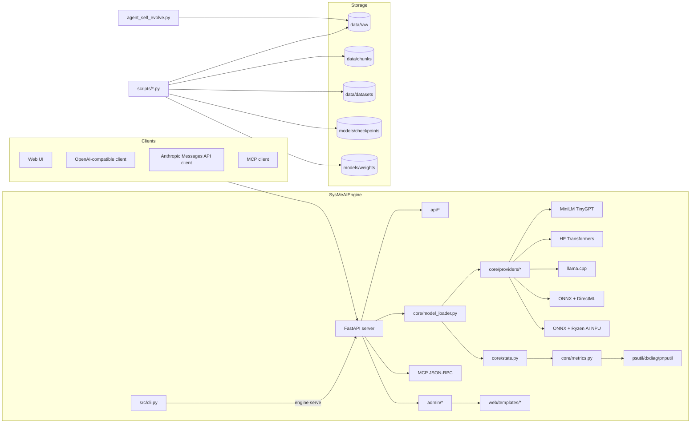

# Architecture

## Key invariants

- **`EngineState`** is a single per-process object: `loaded` model, rolling metrics, agent history, training jobs. Never import-time-singleton — explicit `init_state(cfg)` in `build_app()`.
- **Providers** return `(model, tokenizer)`; `llama.cpp` uses `model == tokenizer`. `minilm` returns its `TinyGPT` (which itself is the tokenizer-holder via `model.tokenizer`).
- **All chat** goes through `core/model_loader.chat()` → records metrics.
- **Embedding** uses `provider.embed()` with mean-pooling fallback for HF models.
- **MCP** uses JSON-RPC over HTTP at `/mcp` — protocol `2025-06-18`, 5 tools, 6 resources, 3 prompts.
- **Templates** are server-rendered Jinja2 + Chart.js (from CDN) — no build step.
